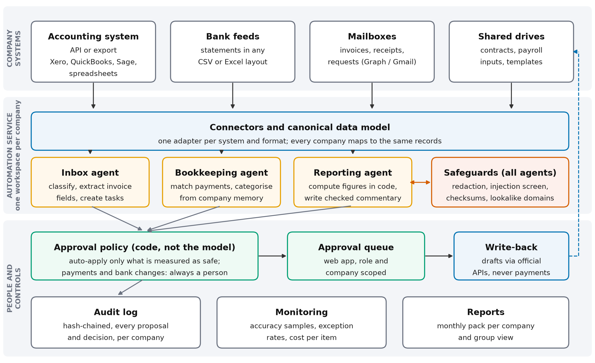

# Back-office agents for a multi-company group

A working prototype of AI agents that run the month-end administration, bookkeeping and reporting for a group of companies on different systems, with the safeguards that work needs: agents propose, a written policy decides, and payments, bank-detail changes and anything suspicious always go to a person.

It is evaluated on 12 synthetic companies with five bank-statement formats, four accounting-export formats, their own charts of accounts and mailboxes, and planted fraud and prompt-injection attempts. Results: [docs/EVALUATION.md](docs/EVALUATION.md).



## What it does

| Agent | Input | Output |
|---|---|---|
| Inbox | Shared mailbox (`.eml`, PDF attachments) | Classifies each email; extracts and checks supplier invoices; turns requests into tasks; blocks bank-change requests, impersonation, lookalike senders and documents carrying hidden instructions |
| Bookkeeping | Bank statement, ledger export, invoices | Matches payments to invoices (short payments, combined payments, mistyped or missing references); categorises transactions from company history first, the matched invoice second, the language model last |
| Reporting | Categorised month | Management report PDF per company: figures computed in code, commentary written by the model and checked number by number |

Everything goes through `control.py`: an approval policy per company, a store per company and a hash-chained audit log. `api.py` is the approval web app (portfolio view, decision queue, audit trail) with company-scoped roles.

## Layout

```
backoffice/   connectors.py  each company's export formats -> one canonical model
              guards.py      redaction, injection screen, IBAN checksum, lookalike domains, invoice checks, number checker
              llm.py         OpenAI-compatible API, in-process open-weight model, per-company response cache
              agents.py      inbox, matching, categorisation, report commentary
              control.py     approval policy, per-company store, audit chain
              reporting.py   management report figures and PDF
              pipeline.py    month-end close for one company
              api.py         approval web app
synth/        synthetic 12-company data generator (all names invented)
eval/         scoring against ground truth, figure, report
tests/        unit tests (parsers, guards, matching, policy, audit, tenant isolation, web access)
runs/final/   recorded model responses and outputs of the evaluated run
```

## Run it

```bash
pip install -r requirements.txt
python synth/generate.py --out data                        # regenerate the 12 companies
python -m pytest                                            # unit tests

# Re-run the evaluated close offline from the recorded model responses
python -m backoffice.cli close --companies data/companies/C* --llm cache --model Qwen/Qwen2.5-7B-Instruct --var var --cache-dir runs/final_v2/llm_cache --llm-for-all
python eval/evaluate.py --runs var --split test

# Live, with any OpenAI-compatible endpoint (hosted API, vLLM, Ollama)
export BACKOFFICE_LLM_BASE_URL=http://localhost:8000/v1
python -m backoffice.cli close --companies data/companies/C04 --llm openai --model Qwen/Qwen2.5-7B-Instruct --var var

# Approval web app
BACKOFFICE_VAR=var BACKOFFICE_SECRET=$(openssl rand -hex 32) uvicorn backoffice.api:app --port 8080
```

## Status

Prototype on synthetic data. Production work would add official API connectors (accounting systems, Microsoft Graph or Gmail), single sign-on, PostgreSQL, a secrets manager, scheduling and monitoring, as set out in the solution design.
